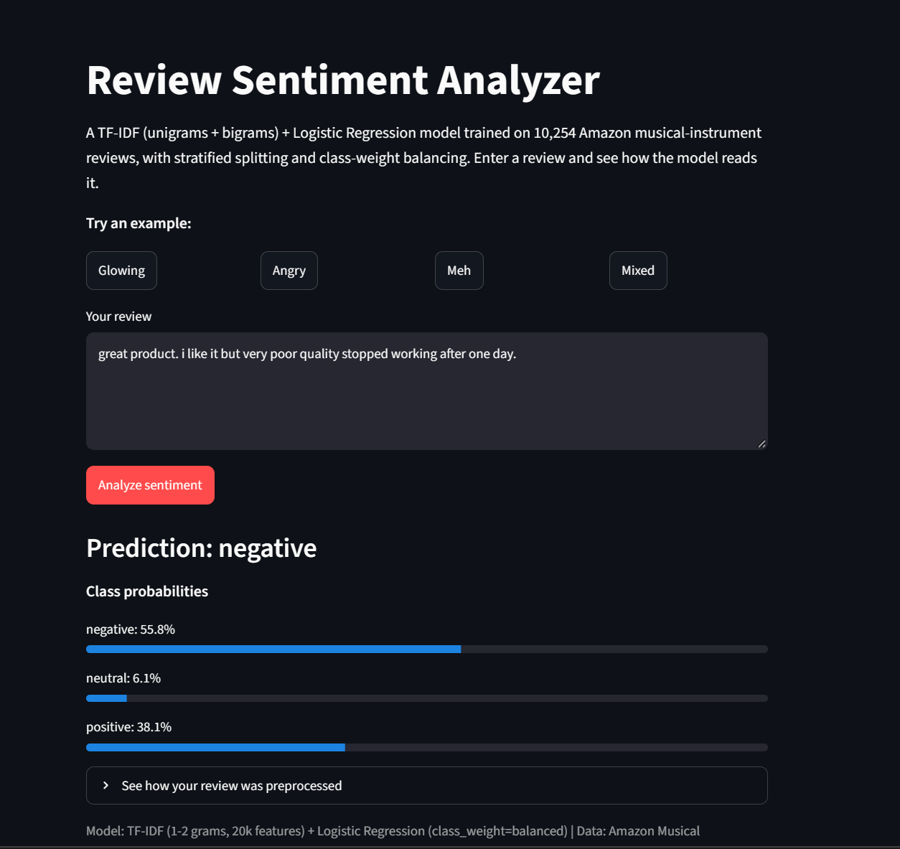
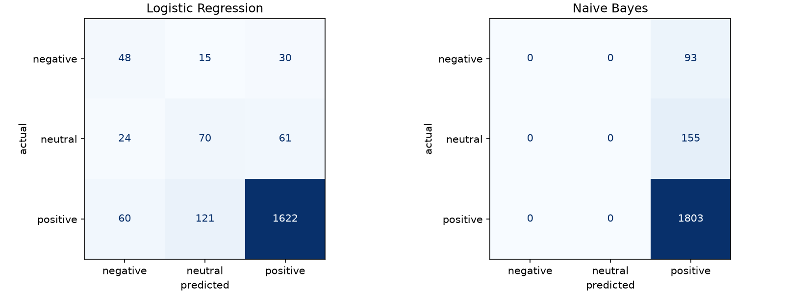
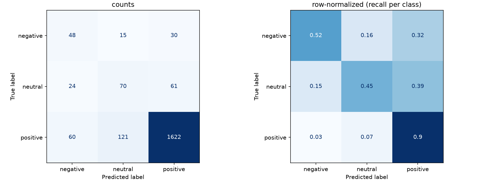
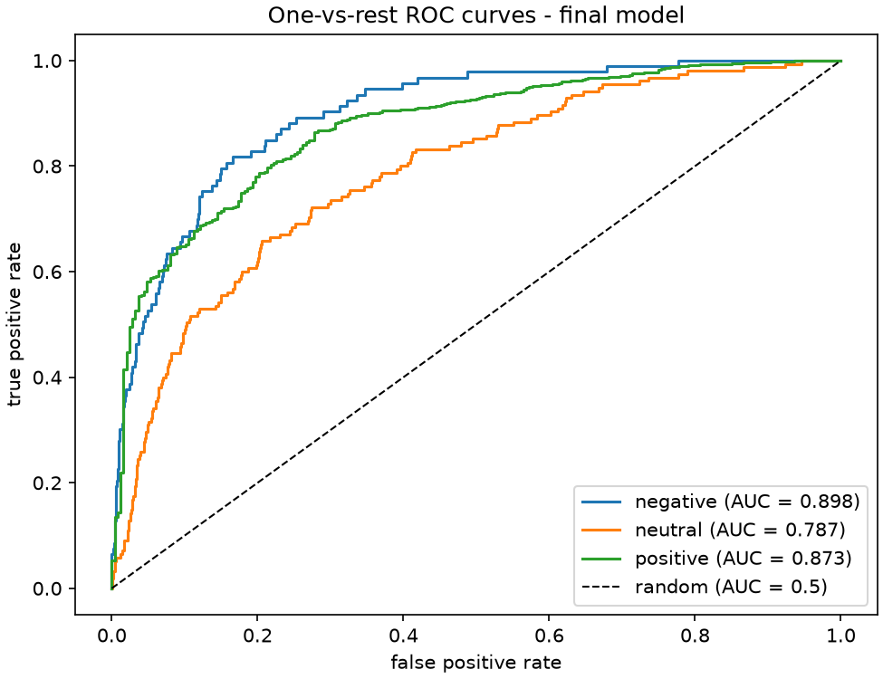
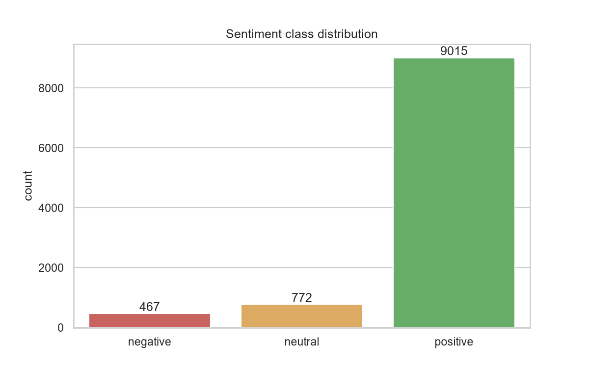
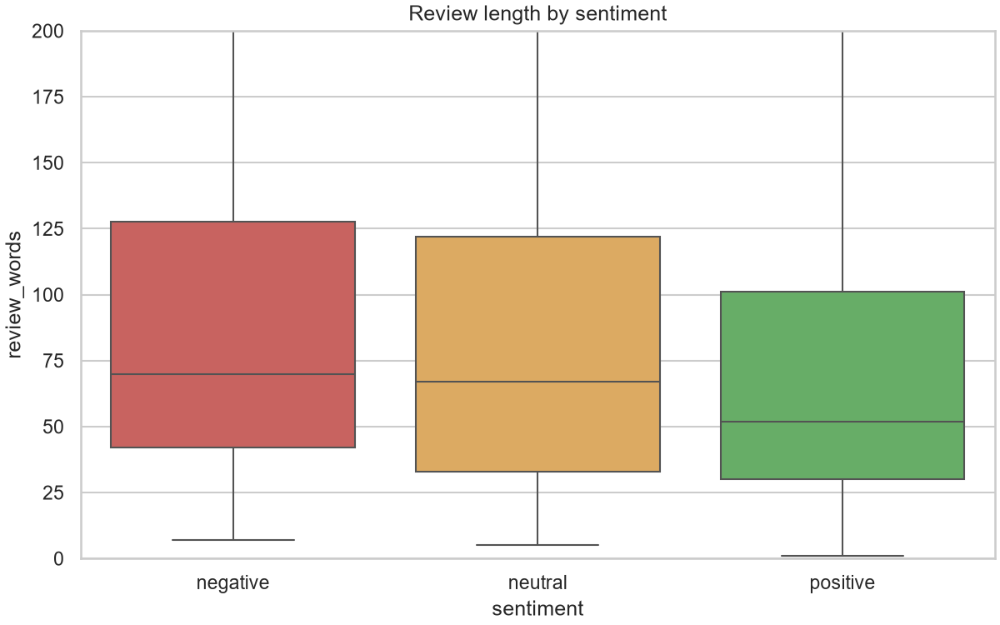
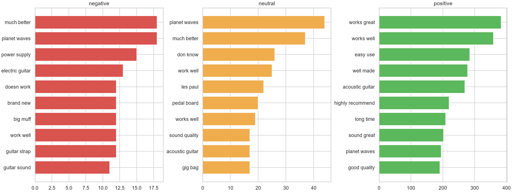
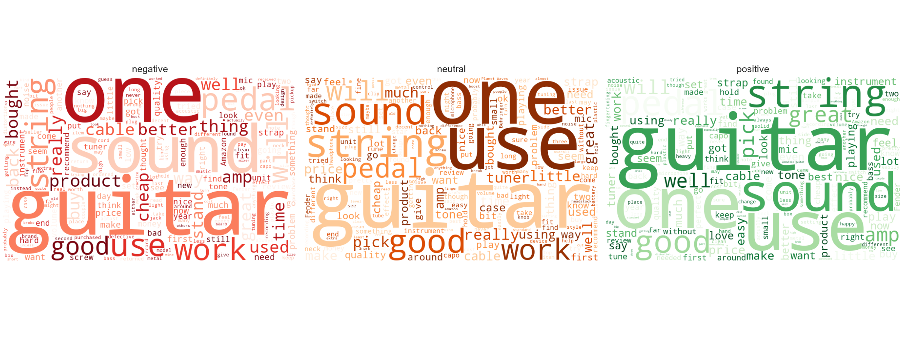

# Sentiment Analysis of Product Reviews

End-to-end sentiment analysis of ~10K Amazon musical-instrument reviews: from raw star ratings to a working Streamlit app, using negation-aware NLTK preprocessing, TF-IDF n-gram features, and class-weighted Logistic Regression.

## The problem

87.9% of the reviews in this dataset are positive. A classifier that predicts "positive" for everything scores 87.9% accuracy — and is completely useless. This project is as much about **honest evaluation under class imbalance** as it is about the model itself.

## Results at a glance

| Model | Accuracy | Macro-F1 | Negative F1 | Neutral F1 | Positive F1 |
|---|---|---|---|---|---|
| Naive Bayes (default) | **0.879** | 0.312 | 0.00 | 0.00 | 0.94 |
| Logistic Regression (final) | 0.848 | **0.579** | **0.43** | **0.39** | 0.92 |

> The default Naive Bayes achieves higher *accuracy* by predicting "positive" for every single review — it never finds a negative or neutral one. Macro-F1 exposes this: every class counts equally, majority or not.

- 5-fold stratified CV macro-F1: **0.512 ± 0.012** · held-out test: **0.579**
- One-vs-rest ROC-AUC: negative **0.898** · positive **0.873** · neutral **0.787**
- Grid search revived Naive Bayes from 0.312 → **0.503** CV macro-F1 (`fit_prior=False`, `alpha=0.1`) — but Logistic Regression won model selection, and the test set was evaluated exactly once.

## What the model learned (top TF-IDF coefficients)

| Pushes toward **negative** | Pushes toward **neutral** | Pushes toward **positive** |
|---|---|---|
| not, broke, defective, returned, garbage, junk, **not recommend** | ok, overall, feel, however, thin | great, perfect, love, best, **work great**, highly |

The negation bigrams engineered during preprocessing (`not work`, `not recommend`) ended up among the model's strongest negative signals — the direct payoff of keeping *no / not / nor / never* out of the stopword list.

## Dataset

[Amazon Musical Instruments Reviews](https://www.kaggle.com/datasets/eswarchandt/amazon-music-reviews) (Kaggle): 10,261 raw reviews, Sept 2004 – July 2014. After cleaning: **10,254 reviews** (7 had no text; zero duplicates found).

Labels are derived from star ratings:

| Rating | Label | Count | Share |
|---|---|---|---|
| 1–2★ | negative | 467 | 4.5% |
| 3★ | neutral | 772 | 7.5% |
| 4–5★ | positive | 9,015 | 87.9% |

## Pipeline

1. **Cleaning** — dropped 7 rows missing review text, parsed `[13, 14]`-style helpful-vote strings, converted unix timestamps to dates.
2. **Preprocessing (NLTK)** — lowercase → contraction expansion (`don't` → `do not`) → negation-preserving stopword removal → WordNet lemmatization.
3. **Features** — TF-IDF over unigrams + bigrams, `min_df=3`, capped at 20,000 features (0.25% dense), fit **on training data only**.
4. **Split** — 80/20 **stratified** train/test (8,203 / 2,051 reviews).
5. **Imbalance handling** — `class_weight="balanced"` in Logistic Regression.
6. **Model selection** — 5-fold stratified CV + GridSearchCV (60 fits) optimizing **macro-F1**; the test set was touched exactly once, at the end.

### EDA insights that shaped the design

- Negative reviews are **longer** (median 70 vs 52 words) — people explain their complaints.

- Bigrams carry the signal: `"doesn't work"` vs `"works great"` (385 occurrences) — the reason features are unigrams **+ bigrams**.

- Domain vocabulary (*guitar, sound, one*) dominates **every** class — exactly why raw counts aren't enough and TF-IDF downweighting matters.
- Negative reviews earn more helpful votes on average (2.03 vs 1.48).

## Where it fails (and why that's informative)

- **Neutral is the hardest class** (F1 0.39, AUC 0.787): it owns no distinctive vocabulary — hedging words like *ok, overall, however* are all it has.
- **Label noise is the ceiling**: labels come from star ratings, so a 3★ review reading *"not greatest cord ever used, not worst either"* is labeled neutral while the text leans negative. 185 of 311 test errors sit on the neutral↔positive boundary.
- **The costly miss**: 30 true negatives were predicted positive — the error a business would care about most.
- WordNet lemmatization defaults to noun POS, so verb forms like *returning* are left unchanged.

## Repository structure

    sentiment-analysis-reviews/
    ├── app/
    │   ├── app.py                 # Streamlit demo application
    │   └── preprocess.py          # shared preprocessing (training == serving)
    ├── data/
    │   ├── raw/                   # Kaggle CSV (not committed)
    │   └── processed/             # cleaned dataset (not committed)
    ├── models/                    # trained pipeline (not committed — rebuild via notebook 02)
    ├── notebooks/
    │   ├── 00_project_setup.ipynb
    │   ├── 01_data_cleaning_and_eda.ipynb
    │   └── 02_model_building.ipynb
    ├── plots/                     # all figures from the analysis
    ├── screenshots/
    ├── .gitignore
    ├── README.md
    └── requirements.txt

## Running it

    git clone https://github.com/Rouen-03/sentiment-analysis-reviews.git
    cd sentiment-analysis-reviews
    pip install -r requirements.txt

    # NLTK resources (app/preprocess.py also downloads these automatically)
    python -c "import nltk; [nltk.download(p) for p in ('punkt','punkt_tab','wordnet','stopwords')]"

    # 1. Download the dataset CSV from Kaggle (link above) into data/raw/
    # 2. Run the notebooks in order to reproduce cleaning, EDA and training
    # 3. Launch the demo app (expects models/sentiment_pipeline.joblib from notebook 02)
    streamlit run app/app.py

## Future Improvements

- Improve neutral-class classification
- Compare Logistic Regression with Complement Naive Bayes and linear SVM
- Evaluate probability calibration and decision thresholds
- Explore POS-aware lemmatization and transformer-based models
- Deploy the application online
